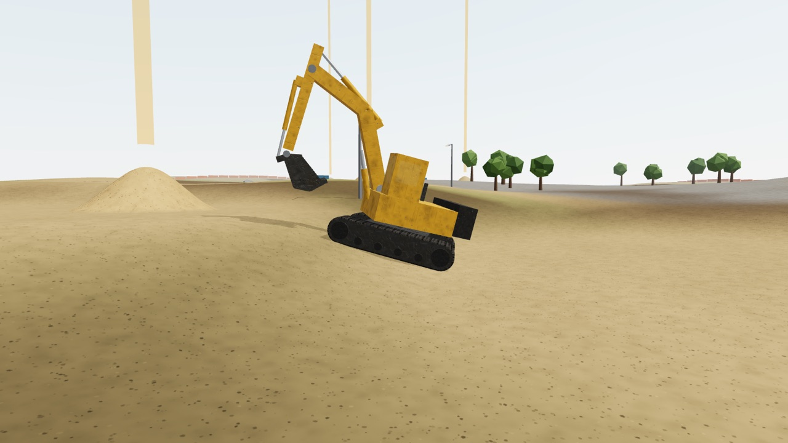
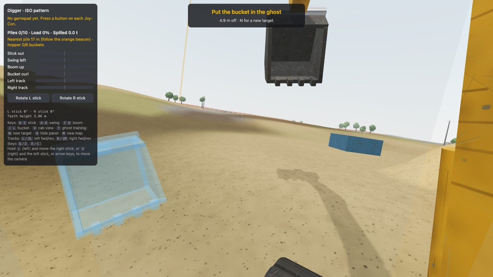
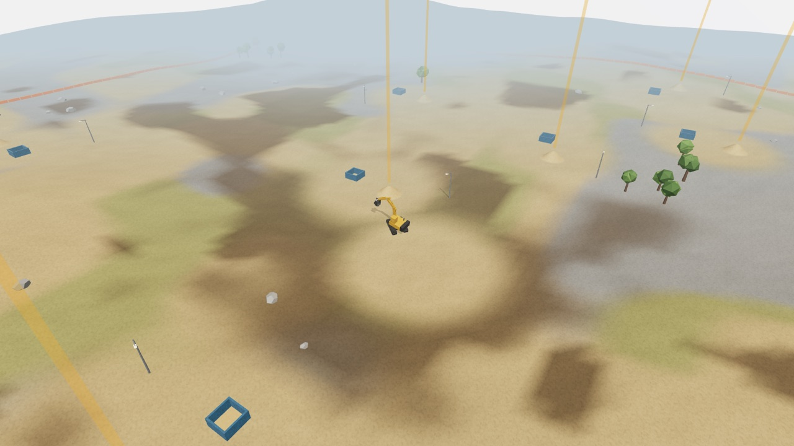

# Digger

A toy excavator for two Joy-Cons (or any two-stick gamepad), using the ISO control pattern.



| | Forward / back | Left / right |
|---|---|---|
| Left stick | Stick out / in | Swing left / right |
| Right stick | Boom down / up | Bucket curl / dump |

## Run

Play it at https://solvemon.github.io/iso-excavator-sim/ (deployed from `main` by GitHub Actions), or run it locally.

No build step. Three.js loads from a CDN. Serve the folder over localhost (the Gamepad API needs a secure context):

```bash
python3 -m http.server 5191 --bind 127.0.0.1
```

Open http://127.0.0.1:5191 in a Chromium-based browser (Firefox lacks Joy-Con support) and press a button on each Joy-Con.

## Calibrating

The panel shows raw axis values per controller. If a stick drives the wrong function, click *Rotate L/R stick* until pushing forward does what the table says. The setting is remembered.

Keyboard fallback: `W/S` stick, `A/D` swing, `I/K` boom, `J/L` bucket, `V` cab view, `T` ghost training, `N` new target, `H` hide panel, `Q/Z` left track, `E/C` right track, arrow keys camera.

## Tracks

Like the foot pedals on a real machine, each track has its own forward and reverse: L / ZL drive the left track forward / backward, R / ZR the right. Both forward drives straight; one forward and one back spins on the spot. The tracks can't drive into the hopper, and the arm gets lifted (or the drive stops) if it would be dragged through the ground. The mound is not solid, so you can drive into it.

## Camera

Hold the camera button (button 12, the up arrow on the left Joy-Con; button 2, the top face button on the right) and the stick on the *other* Joy-Con moves the camera instead of the machine, so one thumb holds the button while the other steers the view. The stick on the same side as the button keeps working the machine.

- **Cab view:** you lean out. Sideways turns your head and leans out that side, forward stands up and peers down, back sits back and looks up. Let go and you settle back into the seat.
- **Outside view:** sideways orbits around the machine, forward/back zooms in and out. The camera stays where you leave it.

The raw panel lists pressed button numbers per pad, in case your Joy-Cons report buttons on other indices. All button numbers live at the top of `src/input.js`.



## Ghost training

Press `T`. A see-through ghost bucket appears somewhere around the machine, always at a pose the real bucket can reach. Move your bucket into it: the ghost turns from blue to yellow to green as you get closer. When both the bucket hinge and the teeth are within 30 cm, hold for half a second and a new target appears. `N` skips a target. There's no score or timer.

## Dig job

Every map is a random 300 × 300 m site with 10 sand piles (about 20 m³ each). Each pile has a blue hopper next to it, on a flat work pad. An orange beacon marks every unfinished pile, and the panel shows the distance to the nearest one. Six full buckets in a hopper completes that pile: a green flag goes up and the beacon goes out. When all 10 are done you get a "Map complete" screen. Click **New map**, press Enter, or press + on the Joy-Con for a fresh random map. `M` starts a new map at any time.

The map comes from a seed in the URL (`#seed=…`). Reloading keeps the same map, and you can share or bookmark the URL to replay it.

There is no physics engine. Filling and pouring are scripted:

- **Filling:** the bucket fills only while its mouth is inside the mound *and moving face-first into it*. Crowding the stick in or curling through the pile works; lowering straight down barely does. What you take leaves a dent, and the mound slowly settles back.
- **Tilt sets capacity:** a curled bucket holds 100%. As the mouth tips past level, the excess pours out from the lower edge. That covers dumping, careless reaching and controlled slow pours.
- **Where it lands:** in the hopper counts as delivered, back on the mound is free, anywhere else counts as spilled. The hopper fills up visibly.
- **Ground, hopper rim, trees, lampposts and boulders:** the arm can't pass through any of them. Pushing the boom down into them stops it. Curling, crowding or swinging into them lifts the boom instead, as hard ground would.



## Terrain

- **Hills:** gentle, at most about 20°, so the machine can drive anywhere. Areas of dirt, dry grass, rock and dark mud follow noise patterns. The work pads around each pile are flattened.
- **Obstacles:** trees in clumps, a lamppost near each work pad and boulders (mostly in rocky areas) block the tracks and the arm. Only the trunks count, so the arm swings through the leaves.
- **Boundary:** orange barriers mark the edge of the map, and the machine can't drive past them.
- **Suspension:** the machine settles onto the terrain with a little spring. It tilts with the slope and dips or lifts slightly when you speed up or brake.

## Files

- `src/excavator.js` – model, joint limits, hydraulic smoothing, ground stop, bucket shape, hydraulic cylinders
- `src/world.js` – seeded map generation: terrain heights, site and obstacle placement, ground and collision queries
- `src/noise.js` – seeded random numbers and value noise
- `src/terrain.js` – terrain mesh with ground-type colours, boundary barriers
- `src/props.js` – trees, lampposts, boulders
- `src/sites.js` – the 10 piles, hoppers and beacons, progress
- `src/mound.js` – sand mound height map: dig, add back, slow refill
- `src/dig.js` – fill and pour rules, falling grains, counters
- `src/site.js` – one hopper: fill level and completion flag
- `src/textures.js` – procedural worn-metal, dirt and sand textures (canvas-generated, no image files)
- `src/cameraRig.js` – cab lean-out and joystick orbit
- `src/input.js` – Joy-Con/gamepad discovery, dead zone, response curve, keyboard
- `src/hud.js` – command bars and raw axis readout
- `src/trainer.js` – ghost bucket targets, reachability check, closeness colour
- `src/main.js` – scene, cameras, loop
